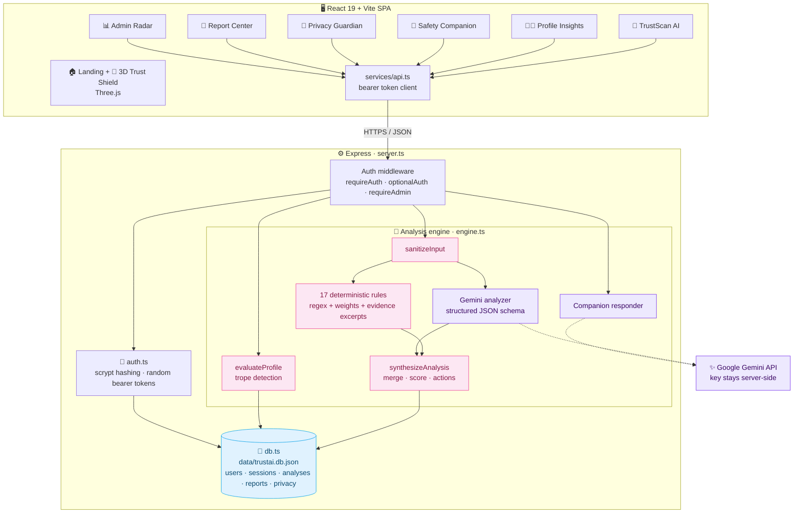
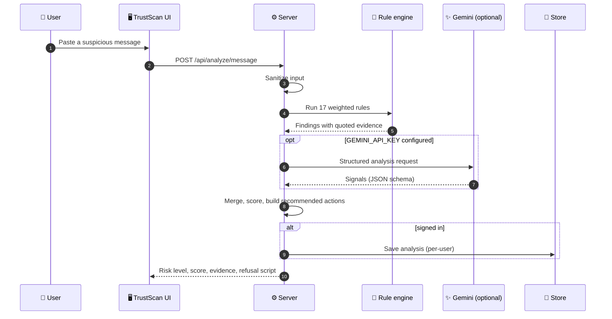
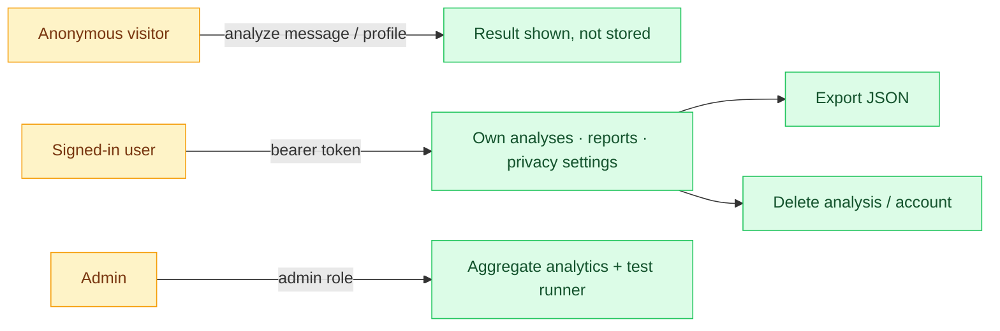

<div align="center">

<br/>

# 🛡️ AFFECIO TrustAI

### Trust Before Connection: Dating Safety, Authenticity & Digital Trust Platform

**Scam-message detection · Profile risk insights · Safety companion · Privacy guardian · Interactive 3D trust shield**

<br/>

<a href="https://affeciso-ai.vercel.app/">
  
</a>

<br/><br/>


<br/>

**[🌐 Live Demo](https://affeciso-ai.vercel.app/)** &nbsp;│&nbsp;
**[✨ Features](#-features)** &nbsp;│&nbsp;
**[🏗️ Architecture](#️-architecture)** &nbsp;│&nbsp;
**[🧠 Detection](#-how-detection-works)** &nbsp;│&nbsp;
**[🚀 Quick Start](#-quick-start)** &nbsp;│&nbsp;
**[📡 API](#-api-reference)** &nbsp;│&nbsp;
**[🗺️ Roadmap](#️-roadmap)**

<br/>

> **AFFECIO Dating & Social Discovery Hackathon** · Problem Statement **PS04: Trust Before Connection, Safety & Authenticity**
> Evidence-first safety for online dating: it flags *behavior and language*, never faces, looks or demographics.

<br/>

</div>

---

<div align="center">

## 📖 Overview

</div>

<div align="center">

Online dating opens doors, and also opens people up to romance scams, "pig-butchering" investment schemes, one-time-code theft, sextortion and pressure to leave the platform.
**AFFECIO TrustAI** reads what a match actually *says*, quotes the exact words that raise concern, explains why, and hands the user a calm, copyable reply.

</div>

<br/>

<div align="center">

| 🔎 Evidence-grounded | ⚖️ Fair by design | 🔐 Privacy-first | 🧯 Never offline-blind |
|:---:|:---:|:---:|:---:|
| Every signal quotes the matching excerpt | No facial or demographic judgments; benign chats stay low-risk | You control retention, export and deletion | Rule engine works without any AI key |

</div>

---

<div align="center">

## ✨ Features

</div>

<div align="center">

| | Module | What it does |
|:---:|:---|:---|
| 💬 | **TrustScan AI** | Analyzes a message for gift-card and crypto requests, OTP / 2FA theft, fabricated emergencies, secrecy pressure, extortion, suspicious links and off-platform lures; returns a 0–100 score, severity, quoted evidence and a refusal script |
| 🧑‍💼 | **Profile Risk Insights** | Checks voluntarily supplied bio claims against known scam tropes (offshore rigs, overseas deployments) and recommends offline verification such as a short live video call |
| 🤝 | **Safety Companion** | A calm advisor for boundaries, de-escalation, safe reply templates and evidence preservation |
| 🔐 | **Privacy Guardian** | Retention settings, one-click JSON data export and instant account and history deletion |
| 📝 | **Report Center** | Incident vault, pre-date safety checklist, emergency-buddy message and shortcuts to reporting resources |
| 🧊 | **3D Trust Shield** | Procedural Three.js shield with three display modes (sentinel, matrix, core) and a control dock |
| 📊 | **Admin Radar** | Aggregated threat categories, usage metrics and a built-in acceptance-test runner |
| 🔑 | **Accounts** | Registration, login, per-user data isolation and admin role |

</div>

---

<div align="center">

## 🏗️ Architecture

</div>



<div align="center">

### 🔄 Message Analysis Pipeline

</div>



<div align="center">

### 🔐 Trust & Privacy Boundaries

</div>



---

<div align="center">

## 🧠 How Detection Works

</div>

<div align="center">

| Signal family | Examples caught |
|:---|:---|
| 💳 **Financial pressure** | Gift-card codes, wire transfers, crypto and "guaranteed returns" platforms |
| 🔑 **Credential theft** | "Send me the code you just got", requests for SSN, bank or card details |
| 🚨 **Fabricated urgency** | Hospital, customs or arrest emergencies, "right now" pressure |
| 🤐 **Coercion & secrecy** | "Don't tell anyone", "if you really loved me" |
| 🕳️ **Extortion** | Threats to leak photos or contact family and employers |
| 🔗 **Suspicious links** | URL shorteners, odd top-level domains, look-alike bank names |
| 📲 **Off-platform lures** | "Move to WhatsApp" very early in the conversation |

</div>

- **Scoring:** the final score takes the heaviest signal and adds a small share of the rest, `max + (sum − max) × 0.15`, capped at 100, so a single critical signal is enough to rate a message as high risk, while ordinary conversation stays near zero.
- **Dual engine:** the rule engine is the always-on baseline; Gemini adds nuance when a key is configured. If the AI call fails, the rule result is still returned.
- **Fairness checks:** the acceptance suite includes a benign "coffee date" case that must stay low-risk (it scores 5/100).

---

<div align="center">

## 🧰 Tech Stack

</div>

<div align="center">

| Layer | Technology |
|:---:|:---|
| 🎨 **Frontend** | React 19 · TypeScript · Vite 8 · Tailwind CSS 4 · Motion · Lucide Icons · Three.js |
| ⚙️ **Server** | Node.js · Express 4 · `tsx` |
| ✨ **AI (optional)** | Google Gen AI SDK, server-side only, JSON-schema responses |
| 🔐 **Security** | scrypt password hashing with per-user salt · random bearer tokens · timing-safe compare · per-user data isolation |
| 💾 **Storage** | File-backed JSON store (`data/trustai.db.json`) |
| ☁️ **Hosting** | Vercel |

</div>

---

<div align="center">

## 🚀 Quick Start

**Prerequisites:** Node.js 18+ · npm

</div>

```bash
git clone https://github.com/Sathihacker2006/AFFECISO-AI.git
cd AFFECISO-AI

npm install
cp .env.example .env        # optional: set GEMINI_API_KEY to enable the AI layer
npm run dev                 # → http://localhost:3000
```

<details>
<summary><b>🔑 Demo accounts (local and judging use only)</b></summary>

| Role | Email | Password |
|:---|:---|:---|
| Judge demo user | `demo@affecio.safety` | `TrustAi2026!` |
| Security admin | `admin@affecio.safety` | `AdminShield2026!` |

These are public demo credentials seeded for evaluation. Change or remove them before any real deployment.

</details>

<details>
<summary><b>⚙️ Environment variables</b></summary>

| Variable | Purpose |
|:---|:---|
| `GEMINI_API_KEY` | Enables the Gemini layer (optional; rules work without it) |
| `AI_MODEL` | Model name used for analysis and the companion |
| `APP_SECRET` | Application secret; set a strong private value outside development |
| `PORT` | Server port (default `3000`) |
| `NODE_ENV` | `development` mounts Vite; `production` serves `dist/` |

</details>

<details>
<summary><b>✅ Tests and scripts</b></summary>

```bash
npm run dev                 # start the server (keep it running)
npm test                    # in a second terminal: 20 acceptance checks against localhost:3000
npm run lint                # tsc --noEmit
npm run build               # production frontend build
```

The acceptance suite calls the running API, so start the server first. It covers hashing, registration, authorization, tenant isolation, evidence-grounded detection, false-alarm prevention, privacy settings, reporting and account deletion.

</details>

<details>
<summary><b>🎬 5-minute demo script</b></summary>

1. **The problem:** why trust matters before a first date.
2. **TrustScan:** run the "Offshore Rig Gift Card Wire" sample and read the quoted evidence and refusal script.
3. **Fairness:** run "Healthy Casual Public Date" and show it stays low-risk.
4. **Profile Insights + Companion:** review the offshore-rig bio and get safe reply guidance.
5. **Privacy + Admin:** export your data, then open the Admin Radar.

</details>

---

<div align="center">

## 📡 API Reference

</div>

<div align="center">

| Method | Endpoint | Auth | Purpose |
|:---:|:---|:---:|:---|
| `POST` | `/api/auth/register` · `/login` · `/logout` | – / ✅ | Account lifecycle |
| `GET` | `/api/auth/me` | ✅ | Current user |
| `POST` | `/api/analyze/message` | optional | Message risk analysis |
| `POST` | `/api/analyze/profile` | optional | Profile trope analysis |
| `POST` | `/api/profile/feedback` | ✅ | Feedback on a profile result |
| `GET` `DELETE` | `/api/analyses` · `/api/analyses/:id` | ✅ | History |
| `GET` `POST` | `/api/reports` | ✅ | Incident reports |
| `GET` `PATCH` | `/api/privacy/settings` | ✅ | Retention and privacy controls |
| `DELETE` | `/api/account` | ✅ | Purge account and data |
| `POST` | `/api/companion/chat` | – | Safety Companion |
| `GET` | `/api/admin/analytics` | 👑 | Aggregate metrics |
| `POST` | `/api/admin/run-tests` | 👑 | Run the acceptance suite |

</div>

---

<div align="center">

## 📁 Project Structure

</div>

```text
AFFECISO-AI/
├── server.ts                    # Express routes, auth guards, static hosting
├── src/
│   ├── App.tsx
│   ├── components/              # LandingPage · MessageAnalyzer · ProfileAnalyzer ·
│   │                            # SafetyCompanion · PrivacyGuardian · ReportCenter ·
│   │                            # AdminPanel · Dashboard · AuthModal · TrustShield3D
│   ├── server/
│   │   ├── engine.ts            # rules, Gemini analyzer, scoring, profile + companion logic
│   │   ├── db.ts                # file-backed store, seeding
│   │   ├── auth.ts              # scrypt hashing, tokens
│   │   └── acceptance_tests.ts  # 20 end-to-end checks
│   ├── services/api.ts          # typed API client
│   └── types/index.ts
├── data/trustai.db.json         # persistent demo data
└── .env.example
```

---

<div align="center">

## 🌐 Deployment

**Live now:** [**affeciso-ai.vercel.app**](https://affeciso-ai.vercel.app/)

</div>

- The app is a **full-stack Express + React** project. For every feature (login, analysis, reports, privacy controls) the server must be running: use `npm run build && npm start` on a Node host, or run it locally.
- The repo has no `vercel.json` or serverless `api/` functions, so a plain static Vercel deploy serves only the front end and the `/api` calls would have nothing to answer them. If the live site shows errors when you sign in or analyze, host `server.ts` or convert the routes to Vercel functions.

---

<div align="center">

## ⚖️ Responsible AI & Scope

</div>

| Principle | Implementation |
|:---|:---|
| **No identity verdicts** | The tool never claims to prove a person is real or fake; it flags observable language and behavior |
| **No appearance or demographic scoring** | Photos and personal attributes are not analyzed |
| **Explainable** | Each signal shows the quoted excerpt, category, severity and reasoning |
| **Human in control** | Output is guidance with safe next steps, not an automated block |
| **Prototype limits** | Regex rules can miss novel phrasing or flag unusual-but-honest messages; storage is a single JSON file; this is not a production safety system |

---

<div align="center">

## 🗺️ Roadmap

</div>

<div align="center">

| Status | Item |
|:---:|:---|
| ✅ | 17-rule detection engine with evidence quotes and optional Gemini layer |
| ✅ | Profile insights, companion, privacy controls, reports, 3D shield |
| ✅ | 20-check acceptance suite |
| 🔜 | Serverless or hosted API so the live demo is fully interactive |
| 🔜 | Database-backed storage and session expiry cleanup |
| 🔜 | Multilingual detection and image-metadata checks (without facial analysis) |
| 💡 | Browser extension that scans chats in place |
| 💡 | Labeled evaluation set to measure precision and recall of the rules |

</div>

---

<div align="center">

## 🤝 Contributing

**Fork** → **Branch** (`feature/your-idea`) → **Commit** → **Push** → **Open a Pull Request**

<br/>

## 📄 License

No license file has been added yet. Add a `LICENSE` file (for example MIT) to define reuse terms.

</div>

---

<div align="center">

## 👨‍💻 Author

**Sathiyamoorthi** · [@Sathihacker2006](https://github.com/Sathihacker2006)

<br/>

> ⚠️ **Disclaimer:** AFFECIO TrustAI is a hackathon prototype that offers guidance, not legal or law-enforcement advice. If you are in danger or being extorted, contact local emergency services and your local cybercrime reporting authority.

<br/>

<a href="https://affeciso-ai.vercel.app/">
  
</a>

<br/><br/>

**⭐ If this project is useful, please star the repo! ⭐**

<sub>Made with ❤️ for the AFFECIO Dating & Social Discovery Hackathon</sub>

</div>
